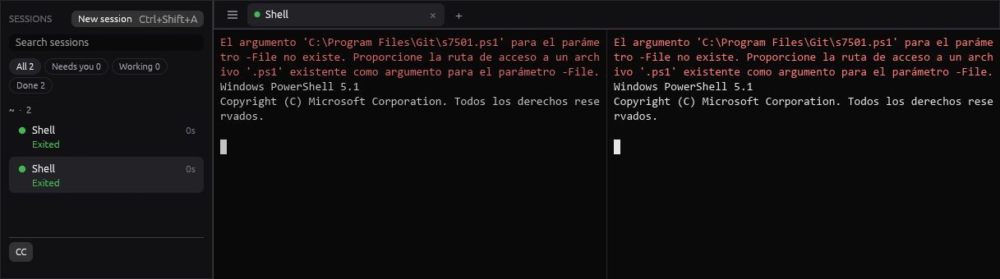

# hivetty

A native, GPU-accelerated terminal written in Rust, built for running **many coding agents at once** (Claude Code, Codex, Gemini CLI, opencode, …). It targets **macOS, Linux (Ubuntu) and Windows**.

> **Status: pre-release, usable from source.** The terminal, tabs and splits work, along with the agent sidebar, notifications, shell integration and the usage dashboard. Installers are not available yet. See the [user guide](docs/user/guide.md).

## What works today

- **Terminal**:
  - GPU rendering (`wgpu`: Metal, Vulkan, DirectX 12) with synchronized output and the Kitty keyboard protocol.
  - Mouse, selection, links, search, IME and a bundled modern ConPTY on Windows.
- **Tabs, splits and windows**:
  - A command palette and shortcuts you can configure.
  - The layout is restored at startup.
- **Agent sidebar**:
  - Live state for each session (*Working*, *Waiting*, *Done*), taken from OSC 7501, Claude Code hooks and notifications.
  - Search and filters, Peek-and-reply, notifications, "go to the next session that needs you", New session and an agent dock.
  - A hover card per session (model, branch, tokens, last tool), a right-click menu, and archive and restore.
  - New sessions in their own git worktree, and notifications forwarded to your phone (ntfy, Telegram or a webhook) if you want.
- **Shell integration** for zsh, bash, fish and PowerShell: prompt marks, the current directory, and project chips showing technology, branch and versions.
- **Usage dashboard** for tokens, tasks and agent time, read from your agents' local logs, with nothing uploaded. It is also available as `hivetty usage`. Add your own `pricing.toml` to see an estimated cost.



## Goals for v1.0

- **A fast terminal that doesn't flicker**:
  - GPU rendering with `wgpu` (Metal / Vulkan / DirectX 12).
  - Correct synchronized output.
  - A modern bundled ConPTY on Windows.
- **Agent sidebar**:
  - Sessions grouped by project, each showing its live state (*Working*, *Waiting*, *Done*).
  - State comes from OSC 7501 and each agent's hooks.
  - An attention inbox, desktop notifications, session resume and git worktrees.
- **Usage dashboard**: tokens (input, cache and output) by model and by agent, plus tasks, agent hours, a daily chart and an activity heatmap. All of it is computed locally; nothing leaves your machine.
- **Shell integration** for zsh, bash, fish and PowerShell, with project "chips" that show the detected technology, branch and versions.
- **First-class Windows support**, not an afterthought.

## Building

```sh
cargo build
cargo run -p hv-app -- --doctor
cargo xtask ci        # same checks as CI: fmt, clippy, tests, cargo-deny
```

Requirements:
- Rust via [rustup](https://rustup.rs) (the version is pinned in `rust-toolchain.toml`).
- macOS: Xcode Command Line Tools.
- Ubuntu: `build-essential pkg-config libfontconfig1-dev libxkbcommon-dev libwayland-dev libx11-dev libvulkan-dev`.
- Windows: Visual Studio Build Tools with the "Desktop development with C++" workload.

## Documentation

The design and planning documents live in [`docs/`](docs/). They are written in Spanish; the application, code and user documentation are in English. Start with [`docs/PLAN.md`](docs/PLAN.md).

## Contributing

See [CONTRIBUTING.md](CONTRIBUTING.md). To report a security issue, see [SECURITY.md](SECURITY.md).

## License

Licensed under either of [Apache License, Version 2.0](LICENSE-APACHE) or [MIT license](LICENSE-MIT), at your option. Unless you explicitly state otherwise, any contribution intentionally submitted for inclusion in this project, as defined in the Apache-2.0 license, shall be dual licensed as above, without any additional terms or conditions.
